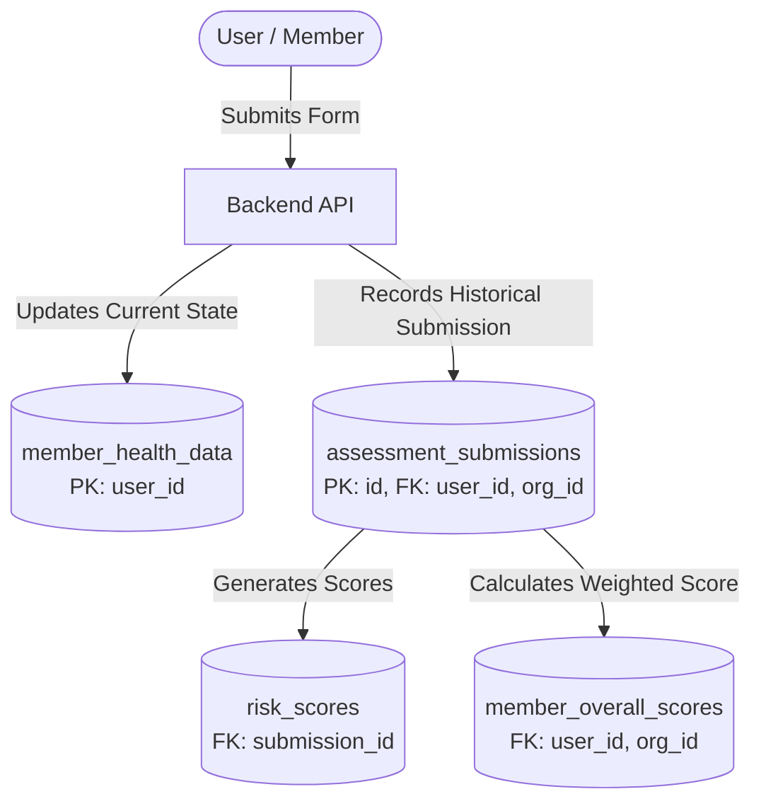
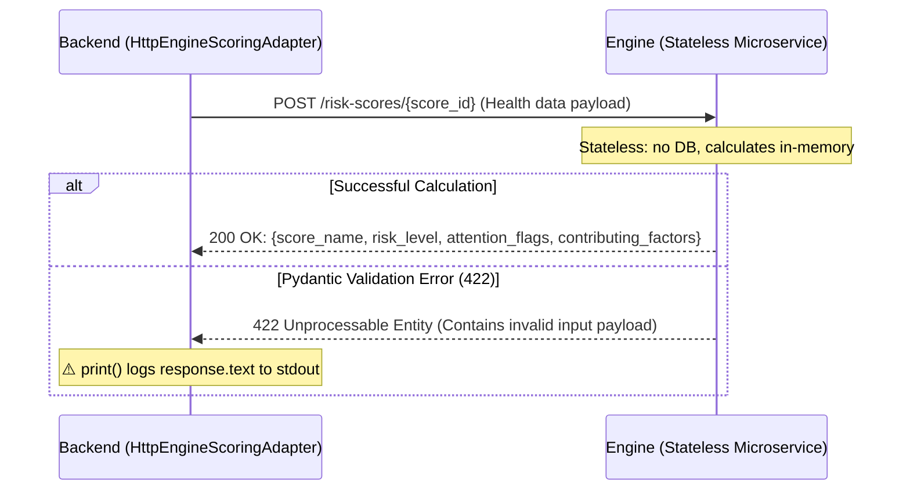

# Health Data Inventory & Privacy Impact Assessment — Checkup360

**Audit Date:** September 28, 2026
**Scope:** Backend, Scoring Engine (Microservice), Frontends (Web, Dashboard, Backoffice), CMS, Infrastructure.
**Status:** Sprint 1 Completed — Repository Audit Only (No application behavior changes).

---

## 1. Personal & Health Data Entry Points

In Checkup360, personal and health data enters through the following Backend API endpoints (`backend/app/presentation/api/routers/`):

| Endpoint | Router | Ingested Data | Classification | Destination / Persistence |
|---|---|---|---|---|
| `POST /members/me/details` | `members.py` | First name, last name, phone number, date of birth, biological sex, height, weight, avatar URL | Personal + Sensitive (Health) | `member_details` + `member_health_data` |
| `PATCH /members/me/profile` | `members.py` | First name, last name, phone number, date of birth, avatar URL | Personal | `member_details` |
| `PATCH /members/me/biometrics` | `members.py` | Biological sex, height, weight | Sensitive (Health) | `member_health_data` |
| `PUT /members/me/forms/{form_type}` | `members.py` | Specific fields belonging to any of the 9 health forms | Sensitive (Health) | `member_health_data` + `assessment_submissions` + `risk_scores` |
| `POST /members/me/assessments/evaluate` | `assessments.py` | Full clinical assessment request payload for immediate scoring | Sensitive (Health) | Stateless per request (not persisted in DB, calls Engine) |
| `POST /invites/{token}/redeem` | `invites.py` | Email, password | Personal / Credential | `user` |

---

## 2. Detailed Inventory of Health Forms & Clinical Fields

Checkup360 defines 9 clinical forms managed by `FormRegistry` (`backend/app/domain/services/form_registry.py`):

| Form (`form_type`) | Collected Fields | Clinical Purpose / Associated Score | Sensitivity Level |
|---|---|---|---|
| **1. `biometrics`** | `biological_sex`, `height`, `weight`, `waist_circumference`, `neck_circumference` | BMI, Stop-BANG, FINDRISC, Metabolic Syndrome calculation | High (Anthropometric / Physical metrics) |
| **2. `sleep`** | `snoring`, `tired`, `observed_apnea`, `neck_circumference` | Obstructive Sleep Apnea screening (Stop-BANG) | High |
| **3. `habits`** | `daily_physical_activity`, `fruits_vegetables`, `hypertension_medication`, `previous_high_glucose`, `family_diabetes`, `smoker` | Type 2 Diabetes risk (FINDRISC) & Cardiovascular risk assessment | High |
| **4. `metabolic`** | `triglycerides`, `total_cholesterol`, `hdl_cholesterol`, `systolic_blood_pressure`, `diastolic_blood_pressure`, `fasting_glucose`, `glucose_lowering_medication` | Metabolic Syndrome (ATP III) & Cardiovascular 10-year risk (SCORE2) | Critical (Laboratory bio-markers & Blood pressure) |
| **5. `eoss`** | `eoss_physical_health_stage`, `eoss_mental_health_stage`, `eoss_functional_stage` | Clinical & functional obesity staging (Edmonton Obesity Staging System) | High |
| **6. `mood` (PHQ-9)** | `little_interest`, `feeling_down`, `sleep_trouble`, `tired_energy`, `appetite`, `feeling_bad`, `concentration`, `psychomotor`, `self_harm_thoughts` | Depressive symptom screening & severity; suicidal/self-harm ideation flag | **Extremely Critical (Mental Health)** |
| **7. `nordic_nmq`** | `nordic_nmq_data` (JSON object containing musculoskeletal symptoms by body area: neck, shoulders, elbows, wrists, upper/lower back, hips, knees, ankles) | Work-related musculoskeletal disorders screening (Standardised Nordic Questionnaire) | High |
| **8. `audit_c`** | `audit_c_frequency`, `audit_c_quantity`, `audit_c_heavy_drinking` | Hazardous alcohol consumption screening (AUDIT-C) | **Critical (Consumption habits / Toxicology)** |
| **9. `pss10`** | `pss10_q1` to `pss10_q10` (10 items on perceived stress) | Perceived stress and workplace burnout evaluation (PSS-10) | High |

---

## 3. Persistence Architecture & Dual Storage

Health data is stored across two distinct relational tables in PostgreSQL:



### 3.1. `member_health_data` Table
- **Primary key:** `user_id` (1 row per user).
- **Purpose:** Snapshot representing the user's current health state. Used to pre-populate forms and provide aggregated input to risk calculation engines.
- **Fields:** 48 columns covering all fields from the 9 forms.

### 3.2. `assessment_submissions` Table
- **Primary key:** `id` (UUID, append-only, immutable historical log).
- **Purpose:** Historical audit log of every form submitted by a member. Ensures temporal and clinical traceability.
- **Fields:** `id`, `user_id`, `organization_id`, `form_type`, `form_version` (currently hardcoded as `"1"`), `status`, `submitted_at`, and a snapshot of the submitted values.

### 3.3. Result Tables: `risk_scores` and `member_overall_scores`
- `risk_scores`: stores `score_name`, `risk_level`, `raw_value`, `normalized_value`, `explanation`, `contributing_factors` (JSON breakdown of responses), and `attention_flags` (JSON).
- `member_overall_scores`: stores historical and current overall health score for an employee within an organization.

---

## 4. Backend ↔ Engine Communication Flow

The Scoring Engine is an independent FastAPI microservice (`engine/`):



### Key Engine Audit Findings:
1. **Stateless Isolation:** The engine maintains no database, file cache, or persistent disk storage. It operates entirely in-memory.
2. **Network Exposure:** In production (`infra/ansible/roles/app_deploy/files/docker-compose.yml`), the engine exposes port 8001 only to the internal Docker network. Caddy **does not** route public traffic to the engine.
3. **Missing Inter-Service Authentication:** HTTP communication between backend and engine does not use an API token, mTLS, or shared authorization headers.
4. **Unfiltered Payloads:** `evaluate_risk()` in `engine_api_adapter.py` sends all non-null fields of `HealthDataDTO` to each calculator endpoint rather than filtering by required fields for that specific calculator.
5. **Log Leakage Risk (`print`):** In `engine_api_adapter.py:76`:
   ```python
   print(f"ENGINE ERROR for {score_id}: {response.text}", flush=True)
   ```
   prints the full 422 error body to stdout, which may contain sensitive submitted health values.

---

## 5. Authorization & Access Control Audit (IDOR)

All endpoints with route identifiers (`user_id`, `organization_id`, `submission_id`, `department_id`) were audited:

| Router | Route | Authorization Verification | Status |
|---|---|---|---|
| `organizations.py` | `GET/PATCH /{organization_id}` | Verifies superuser or `get_admin_membership(current_user.id, org_id)`. | ✅ Secure |
| `organizations.py` | `GET/POST/PATCH/DELETE /{organization_id}/departments/*` | Verifies admin role in organization and entity ownership. | ✅ Secure |
| `organizations.py` | `PATCH/DELETE /{organization_id}/employees/{user_id}/*` | Verifies actor is admin and target belongs to the same org. | ✅ Secure |
| `organizations.py` | `GET /{organization_id}/employees` | Verifies admin role in `organization_id`. | ✅ Secure |
| `organizations.py` | `GET /{organization_id}/employees/{user_id}/assessments` | `_ensure_employee_access()` checks employee belongs to admin's org. | ✅ Secure |
| `organizations.py` | `GET /{organization_id}/employees/{user_id}/assessment-submissions` | `_ensure_employee_access()` + `list_for_employee(organization_id, user_id)` filter. | ✅ Secure |
| `organizations.py` | `GET /{organization_id}/employees/{user_id}/assessment-submissions/{submission_id}` | Verifies admin in org + submission matches both `user_id` and `organization_id`. | ✅ Secure |
| `assessments.py` | `GET /members/me/assessment-submissions/{submission_id}` | Verifies submission matches authenticated JWT `user.id` and `organization_id`. | ✅ Secure |
| `members.py` | `/members/me/*` | Uses `get_current_user` and `require_member_role`. No `user_id` in route; operates on authenticated token. | ✅ Secure |
| `admin.py` | `/admin/*` | Protected by `require_superuser` dependency. | ✅ Secure |

**Conclusion:** Access controls and multi-tenant boundaries are strictly enforced. No direct IDOR vulnerabilities were found.

---

## 6. Organization Admin Visibility Over Employee Health Data

The audit confirmed the exact health data visible to Organization Admins (`admin` or `superadmin` roles in a company):

1. **Roster Overview (`GET /{org_id}/employees`):**
   - First/last name, email, department, onboarding status.
   - Date of last assessment (`last_assessment`).
   - Overall health score (`overall_score`).
2. **Individual Clinical Assessments (`GET /{org_id}/employees/{user_id}/assessments`):**
   - Full list of computed scores (PHQ-9 Depression, FINDRISC Diabetes, SCORE2 Cardiovascular, Stop-BANG Apnea, etc.).
   - Qualitative risk levels ("High", "Moderate", "Low"), raw values, and normalized scores.
   - Clinical explanations.
   - Itemized contributing factors (`contributing_factors`).
   - Clinical attention flags (`attention_flags`, e.g. self-harm warning in PHQ-9).
3. **Individual Raw Form Answers (`GET /{org_id}/employees/{user_id}/assessment-submissions/{submission_id}`):**
   - **Full access to the raw answers submitted by the employee**, including:
     - Mental health responses from PHQ-9 (e.g., `self_harm_thoughts`, `feeling_down`, `psychomotor`, etc.).
     - Alcohol consumption details from AUDIT-C (frequency, quantity, heavy drinking episodes).
     - Clinical lab values (fasting glucose, cholesterol, triglycerides, diabetes/hypertension medication).
     - Musculoskeletal and sleep symptoms.

> [!WARNING]
> **Key Compliance Finding:** Employers currently have access not only to aggregated statistics or overall scores, but to **granular, raw psychiatric and clinical questionnaire answers**. This must be explicitly addressed in policy and consent texts.

---

## 7. Third-Party Services, Hosting & International Data Transfers

| Provider / Service | Role in Platform | Processed Data | Location | Compliance Aspect (Ley 25.326 / International Transfers) |
|---|---|---|---|---|
| **Resend (`resend` SDK)** | Listed in `pyproject.toml` (v2.30.1) | Email, recipient name, invite URLs | United States (AWS us-east-1) | International transfer to country without adequacy status under AAIP; requires standard contractual clauses or explicit user consent. |
| **Google OAuth** | Social login / authentication | Email, full name, Google User ID | United States / Global | Delegated authentication; health data is never shared with Google. |
| **SMTP Server (e.g., Gmail / Custom)** | Transactional email delivery (invites, password resets) | Recipient email, tokenized links | Determined by `SMTP_HOST` | Delivery transit of invitation and reset credentials. |
| **Dozzle** | Container log viewer in backoffice | stdout/stderr logs of containers | Local Host / VPS | Protected via `forward_auth` for sysadmins. Requires ensuring health data is never printed to logs. |
| **Payload CMS** | Health education & article CMS | Articles, authors, media | Local Host / VPS | Operates on dedicated CMS tables; no access to member health records. |

---

## 8. Open [HUMAN DECISION] Items (Legal & Organizational Alignment)

- ⚖️ **[DECISION 1] AAIP Database Registration:**
  Will the data controller register the health and employee databases with the National Registry of Databases (AAIP, Art. 21, Argentine Personal Data Protection Act 25.326)?
- ⚖️ **[DECISION 2] International Data Transfers:**
  Confirm legal basis for third-party services in foreign jurisdictions (Google OAuth, Resend, foreign VPS hosting) via standard clauses or explicit consent.
- ✅ **[DECISION 3] Employer Visibility Level (Confirmed):**
  Organization Admins and authorized occupational health medical staff maintain access to employee assessments, calculated scores, and health form indicators for workplace preventative health management. Informed consent and privacy policy documents explicitly disclose this access scope.
- ⚖️ **[DECISION 4] Consent Granularity:**
  Confirm the adoption of individual informed consent for each of the 9 health forms (recommended for maximum legal defense with sensitive data) vs. grouped category consents.
- ⚖️ **[DECISION 5] Revocation & Data Lifecycle:**
  Upon consent revocation or erasure request (Art. 16, Act 25.326), should historical submissions in `assessment_submissions`, `member_health_data`, `risk_scores`, and `member_overall_scores` be deleted or irreversibly anonymized for epidemiological analytics?
- ⚖️ **[DECISION 6] Minor Policy:**
  Confirm strict prohibition for individuals under 18 years of age (enforced via `date_of_birth` validation during onboarding).
- ⚖️ **[DECISION 7] PHQ-9 Crisis Protocol (Item 9 / Self-harm):**
  Approval of advisory copy and hotlines/referrals (e.g. National Suicide Prevention Helpline 135 / occupational health channel) displayed when `attention_flags.self_harm_thoughts` is triggered.
