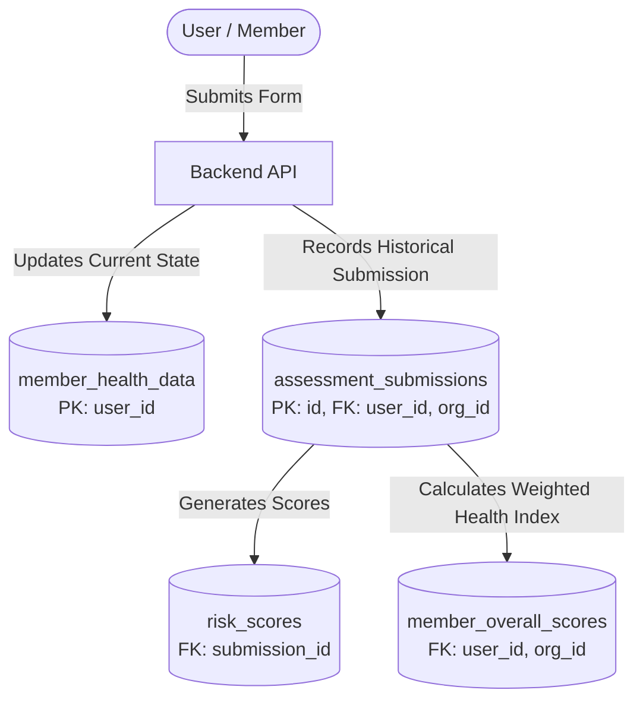
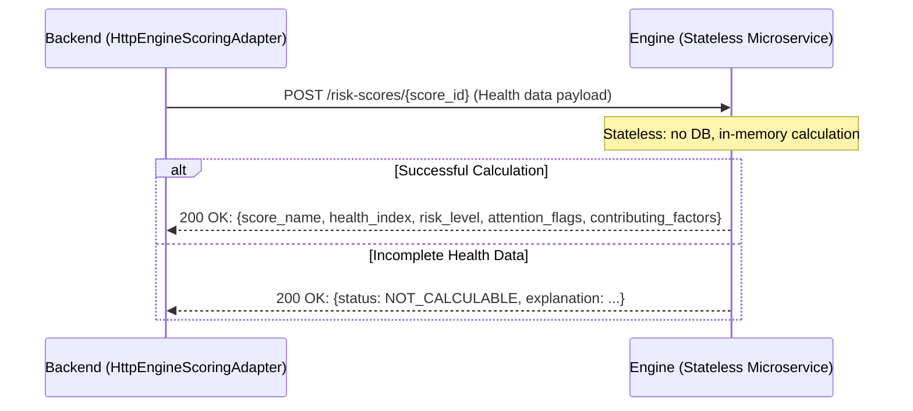

# Health Data Inventory & Privacy Architecture — Checkup360

**Scope:** Backend, Scoring Engine, Frontends (Web, Dashboard, Backoffice), CMS, Infrastructure.
**Applicable Regulations:** Ley 25.326 (Protección de Datos Personales), Ley 26.529 (Derechos del Paciente e Historia Clínica), Ley 24.557 (Riesgos del Trabajo / SRT).
**Status:** Production Architecture Specification.

---

## 1. Personal & Health Data Entry Points

In Checkup360, personal and health data enters through the following Backend API endpoints (`backend/app/presentation/api/routers/`):

| Endpoint | Router | Ingested Data | Classification | Destination / Persistence |
|---|---|---|---|---|
| `POST /members/me/details` | `members.py` | First name, last name, phone number, date of birth, biological sex, height, weight, avatar URL | Personal + Sensitive (Health) | `member_details` + `member_health_data` |
| `PATCH /members/me/profile` | `members.py` | First name, last name, phone number, date of birth, avatar URL | Personal | `member_details` |
| `PATCH /members/me/biometrics` | `members.py` | Biological sex, height, weight | Sensitive (Health) | `member_health_data` |
| `PUT /members/me/forms/{form_type}` | `members.py` | Specific fields belonging to any of the 9 health forms | Sensitive (Health) | `member_health_data` + `assessment_submissions` + `risk_scores` |
| `POST /members/me/assessments/evaluate` | `assessments.py` | Full clinical assessment request payload for immediate scoring | Sensitive (Health) | Stateless per request (calls Engine, not persisted directly) |
| `POST /invites/{token}/redeem` | `invites.py` | Email, password | Personal / Credential | `user` |

---

## 2. Detailed Inventory of Health Forms & Clinical Fields

Checkup360 defines 9 clinical forms managed by `FormRegistry` (`backend/app/domain/services/form_registry.py`):

| Form (`form_type`) | Collected Fields | Clinical Purpose / Associated Score | Sensitivity Level |
|---|---|---|---|
| **1. `biometrics`** | `biological_sex`, `height`, `weight`, `waist_circumference`, `neck_circumference` | BMI, Stop-BANG, FINDRISC, Metabolic Syndrome calculation | High (Anthropometric / Physical metrics) |
| **2. `sleep`** | `snoring`, `tired`, `observed_apnea`, `neck_circumference` | Obstructive Sleep Apnea screening (Stop-BANG) | High |
| **3. `habits`** | `daily_physical_activity`, `fruits_vegetables`, `hypertension_medication`, `previous_high_glucose`, `family_diabetes`, `smoker` | Type 2 Diabetes risk (FINDRISC) & Cardiovascular risk assessment | High |
| **4. `metabolic`** | `triglycerides`, `total_cholesterol`, `hdl_cholesterol`, `systolic_blood_pressure`, `diastolic_blood_pressure`, `fasting_glucose`, `glucose_lowering_medication` | Metabolic Syndrome (ATP III) & Cardiovascular 10-year risk (SCORE2) | Critical (Laboratory bio-markers & Blood pressure) |
| **5. `eoss`** | `eoss_physical_health_stage`, `eoss_mental_health_stage`, `eoss_functional_stage` | Clinical & functional obesity staging (Edmonton Obesity Staging System) | High |
| **6. `mood` (PHQ-9)** | `little_interest`, `feeling_down`, `sleep_trouble`, `tired_energy`, `appetite`, `feeling_bad`, `concentration`, `psychomotor`, `self_harm_thoughts` | Depressive symptom screening & severity; suicidal/self-harm ideation flag | **Extremely Critical (Mental Health)** |
| **7. `nordic_nmq`** | `nordic_nmq_data` (JSON object containing musculoskeletal symptoms across 9 anatomical zones) | Work-related musculoskeletal disorders screening (Standardised Nordic Questionnaire) | High |
| **8. `audit_c`** | `audit_c_frequency`, `audit_c_quantity`, `audit_c_heavy_drinking` | Hazardous alcohol consumption screening (AUDIT-C) | **Critical (Toxicology & Consumption habits)** |
| **9. `pss10`** | `pss10_q1` to `pss10_q10` (10 items on perceived stress) | Perceived stress and workplace burnout evaluation (PSS-10) | High |

---

## 3. Persistence Architecture & Dual Storage

Health data is stored across two distinct relational tables in PostgreSQL:

### 3.1. `member_health_data` Table
- **Primary key:** `user_id` (1 row per user).
- **Purpose:** Snapshot representing the user's latest health state. Used to pre-populate questionnaires and provide aggregated input to scoring engines.
- **Fields:** Columns covering current physical, habits, metabolic, and clinical parameters.

### 3.2. `assessment_submissions` Table
- **Primary key:** `id` (UUID, append-only, immutable historical log).
- **Purpose:** Historical audit log of every form submitted by a member. Ensures temporal and clinical traceability.
- **Fields:** `id`, `user_id`, `organization_id`, `form_type`, `form_version`, `consent_id`, `status`, `submitted_at`, and snapshot of submitted values.

### 3.3. Result Tables: `risk_scores` and `member_overall_scores`
- `risk_scores`: stores `score_name`, `risk_level`, `raw_value`, `health_index` (0–100, higher is healthier), `explanation`, `contributing_factors` (JSON breakdown), and `attention_flags` (JSON).
- `member_overall_scores`: stores historical and current overall health index (`overall_health_index`) and categorical classification for an employee within an organization.

---

## 4. Backend ↔ Engine Communication Flow

The Scoring Engine is an independent, stateless FastAPI microservice (`engine/`):

### Key Engine Architecture Invariants:
1. **Stateless Isolation:** The engine maintains no database, session state, or persistent disk storage.
2. **Network Isolation:** In deployment, the engine communicates strictly over the private internal Docker network. Public HTTP ingress (Caddy) does not expose engine ports.
3. **Unified Direction:** All calculators compute clinical severity internally, but expose scores exclusively as `health_index` (0–100, where higher is healthier).

---

## 5. Authorization & Multi-Tenant Access Control

All endpoints enforce role-based access control (RBAC) and strict tenant boundaries:

| Router | Route Scope | Authorization Verification | Boundary |
|---|---|---|---|
| `organizations.py` | `/{organization_id}/*` | Verifies actor has `ADMIN` or `SUPERADMIN` membership in target organization. | Strict Tenant Isolation |
| `organizations.py` | `/{organization_id}/employees/{user_id}/*` | Verifies employee belongs to the same organization. | Strict Tenant Isolation |
| `assessments.py` | `/members/me/assessment-submissions/{id}` | Verifies submission belongs to authenticated JWT `user.id`. | Strict Ownership |
| `members.py` | `/members/me/*` | Operates on authenticated JWT token (`require_member_role`). | Strict Ownership |
| `consents.py` | `/members/me/consents/*` | Operates on authenticated JWT token. | Strict Ownership |
| `admin.py` | `/admin/*` | Protected by `require_superuser` dependency. | Platform Administration |

---

## 6. Organization Admin Visibility Over Employee Health Data

Access to employee health information by Organization Admins (`admin` / `superadmin` roles) is strictly governed:

1. **Workforce Roster (`GET /{org_id}/employees`):**
   - Employee identification: Name, email, department, onboarding status.
   - Preventative indicators: Date of last assessment, overall health index (`overall_health_index`), and categorical health band.
2. **Clinical Score Summaries (`GET /{org_id}/employees/{user_id}/assessments`):**
   - Health indexes, qualitative risk bands, and clinical attention flags (e.g. self-harm warnings, high cardiovascular risk).
3. **Transparency & Consent:**
   - Informed consent notices explicitly state that preventative health data is made available to authorized occupational health managers and company medical staff for workplace wellness programs.

---

## 7. Third-Party Services & Infrastructure

| Provider / Service | Role in Platform | Processed Data | Location | Compliance Safeguards |
|---|---|---|---|---|
| **Resend / SMTP** | Transactional email delivery | Email, recipient name, tokenized invite / reset URLs | Configured via `SMTP_HOST` | Delivery transit for credentials and activation links. |
| **Google OAuth** | Optional social login | Email, full name, Google User ID | United States / Global | Delegated authentication; health data is never shared with Google. |
| **Dozzle** | Operational container log viewer | Technical stdout/stderr logs | Internal Host / Private | Protected by `forward_auth`; technical logs sanitize sensitive clinical payloads. |
| **Payload CMS** | Health education & article CMS | Articles, authors, media | Internal Host / Private | Dedicated CMS database schema; no access to member health records. |

---

## 8. Implemented Privacy & Regulatory Architecture

The platform enforces the following core privacy principles:

1. **Informed Consent Architecture:**
   - *Level 1 (Onboarding):* Mandatory acceptance of Terms & Conditions, Privacy Policy, and General Health Data Processing Consent.
   - *Level 2 (Questionnaires):* Granular informed consent per clinical form (`FORM_CONSENT` for each of the 9 form types).
2. **Minor Protection:**
   - Checkup360 is strictly restricted to adults ($\ge 18$ years old). Registration of minors is blocked at the API level via `date_of_birth` validation (`minimum_age_required_18`).
3. **Revocation & Retention Lifecycle:**
   - Members can revoke form consent at any time. Revocation immediately blocks subsequent data submissions for that questionnaire.
   - Historical records are retained in append-only storage (`assessment_submissions`) for 10 years to comply with clinical traceability obligations (Ley 26.529, Art. 18).
4. **Habeas Data Rights (Self-Service Data Export):**
   - Members can exercise their right of access and portability (`GET /members/me/export`) to download their complete portfolio of personal information, form submissions, and consent history.
5. **Mental Health Crisis Protocol:**
   - Positive responses on PHQ-9 Item 9 (`self_harm_thoughts`) trigger immediate safety assistance resources and confidential crisis hotlines within the user interface.
