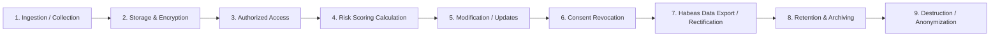

# Data Lifecycle & Retention Policy — Checkup360

**Version:** 1.0
**Effective Date:** September 2026
**Scope:** Checkup360 Platform (Backend, Database, Frontends, Analytics Engine)
**Applicable Regulations:** Ley 25.326 (Protección de Datos Personales de la República Argentina), Ley 26.529 (Derechos del Paciente, Historia Clínica y Consentimiento Informado), Ley 24.557 (Riesgos del Trabajo / Normativas SRT).

---

## 1. Lifecycle Overview

The lifecycle of personal and clinical health data within Checkup360 follows a strict unidirectional and audited progression:

---

## 2. Detailed Stages

### Stage 1: Ingestion & Collection
- **Prerequisites:** Explicit and unbundled consent must be granted before collecting any health data:
  - *Level 1 (Onboarding):* Terms and Conditions (`TERMS_AND_CONDITIONS`), Privacy Policy (`PRIVACY_POLICY`), and General Health Data Processing Consent (`HEALTH_DATA_PROCESSING_CONSENT`).
  - *Level 2 (Forms):* Specific informed consent per form (`FORM_CONSENT` for each of the 9 clinical form types).
- **Age Policy (Minor Restriction):** Checkup360 is strictly restricted to individuals aged 18 and older. Registration of minors is blocked at the API level via `date_of_birth` validation (`minimum_age_required_18`).
- **Entry Points:** Ingestion occurs exclusively through authenticated HTTPS endpoints: `POST /members/me/details`, `PATCH /members/me/biometrics`, and `PUT /members/me/forms/{form_type}`.

### Stage 2: Storage & Partitioning
- **Dual-Layer Relational Persistence:**
  - `member_health_data`: Active snapshot representing the member's current health state (1 row per user).
  - `assessment_submissions`: Append-only, immutable historical log of every form submitted, recording `user_id`, `organization_id`, `form_type`, `form_version`, `consent_id`, and exact submitted answers.
  - `audit_logs`: Immutable audit trail recording every security, consent, and data export event.
- **Data Protection:** Managed PostgreSQL storage with TLS-in-transit, connection pooling, and restricted schema access.

### Stage 3: Authorized Access & Segregation
- **Role-Based Access Control (RBAC):**
  - *Member (`MEMBER`):* Access strictly restricted to own profile, historical submissions, scores, and personal data exports.
  - *Organization Admin (`ADMIN` / `SUPERADMIN`):* Access restricted to organizational workforce overview, aggregated department health analytics, and compliance audit summaries.
  - *System Admin (`SYSADMIN`):* Platform-level operational monitoring and system audit logs.
- **Tenant Isolation:** All database queries enforce strict `organization_id` boundary checks. Cross-organization data leakage is prevented at both domain and use case layers.

### Stage 4: Risk Scoring Calculation
- **Microservice Communication:** Health inputs are transmitted from Backend to Engine via internal network HTTP calls (`HttpEngineScoringAdapter`).
- **Stateless Scoring:** The scoring engine is stateless and in-memory; it does not persist health inputs or patient records.
- **Privacy Controls:** Responses and error logs are sanitized to prevent clinical payload leakage into log sinks.

### Stage 5: Modification & Rectification
- **Current State Updates:** Users can update their latest biometrics and answers by submitting an updated form.
- **Historical Immutability:** Previous submissions in `assessment_submissions` remain intact to preserve temporal medical traceability.

### Stage 6: Consent Revocation
- **Revocation Action:** Users can revoke consent for any specific form or general consent at any time via `POST /consents/{id}/revoke`.
- **Enforcement:**
  - Upon revocation, the active consent record is stamped with `revoked_at` and an immutable `CONSENT_REVOKED` audit event is logged.
  - The backend immediately blocks any further submission or processing of health data for that form (`403 Forbidden: consent_required`).
  - *Historical Data Treatment:* Past submissions and calculated scores prior to the revocation date remain stored in `assessment_submissions` for medical-legal traceability and compliance auditing.

### Stage 7: Habeas Data Rights (Access & Export)
- **Right of Access & Portability (Art. 14, Ley 25.326):**
  - Members can download their full personal and health portfolio at any time via `GET /members/me/export`.
  - The export provides a structured, complete JSON file containing personal details, all historical form submissions, consent history, active risk scores, and overall metrics.
  - Every export generates an immutable `DATA_EXPORTED` audit log entry.

---

## 3. Data Retention & Archiving Policy

| Data Category | Tables / Entities | Active Retention Period | Post-Termination Retention | Final Action | Legal Basis |
|---|---|---|---|---|---|
| **Account & Identity** | `users`, `member_details`, `invite_tokens` | Duration of active organization membership | 30 days after account deletion request | Permanent deletion | Art. 4 & 16, Ley 25.326 |
| **Active Health Snapshot** | `member_health_data` | Duration of active organization membership | Reset upon employment termination | Cleared / Reset | Principle of Quality & Purpose Limitation |
| **Clinical Submissions & Forms** | `assessment_submissions` | Duration of active organization membership | **10 years** in passive archive | Irreversible anonymization / Secure deletion | Ley 26.529 (Art. 18), Ley 24.557, SRT occupational health regulations |
| **Calculated Risk Scores** | `risk_scores`, `member_overall_scores` | Duration of active organization membership | **10 years** in passive archive (linked to submission history) | Irreversible anonymization / Secure deletion | Ley 26.529, Ley 24.557 |
| **Consent & Audit Trails** | `user_consents`, `audit_logs` | Duration of active organization membership | **10 years** | Archived / Retained for legal compliance | Art. 10 & 21, Ley 25.326 |
| **System & Operational Logs** | Web server & application structured logs | 90 days rolling window | N/A | Automatic log rotation & purge | Information Security best practices |

---

## 4. Erasure & Destruction Procedures

1. **Member Account Suppression (Right to be Forgotten):**
   - Personal identifiers (email, password hash, phone number, name, avatar) are purged from active tables (`users`, `member_details`).
   - Historical clinical records in `assessment_submissions` are disassociated from personal identities or retained under restricted archive status during the mandatory 10-year legal period.
2. **Database Backups:**
   - Database dumps and snapshots are encrypted at rest with AES-256.
   - Backup retention cycle is automated (daily backups retained for 30 days, monthly snapshots retained for 1 year).
   - Once a backup exceeds its retention lifecycle, the underlying storage volume is permanently shredded.
